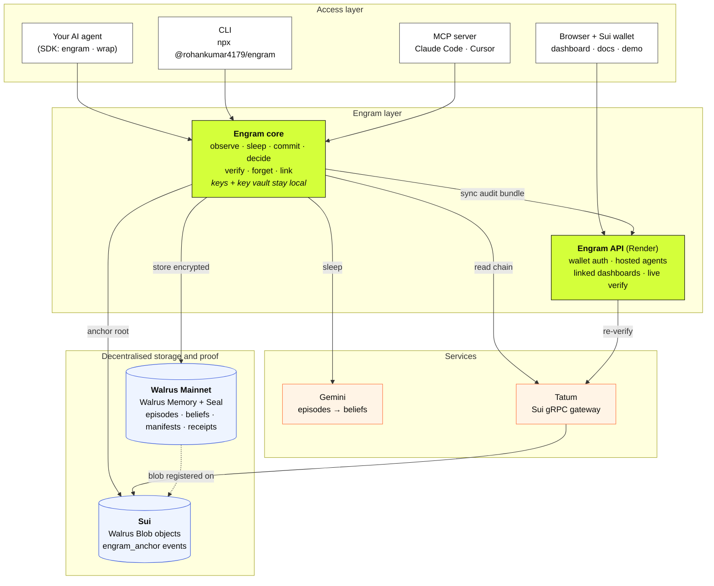
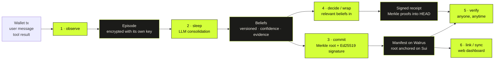
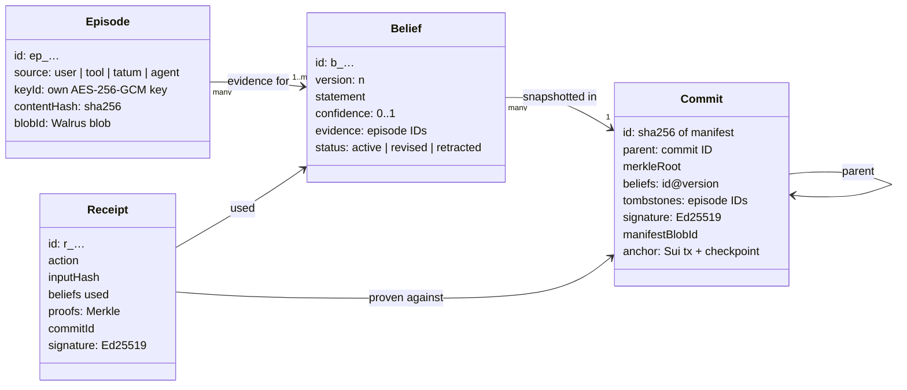
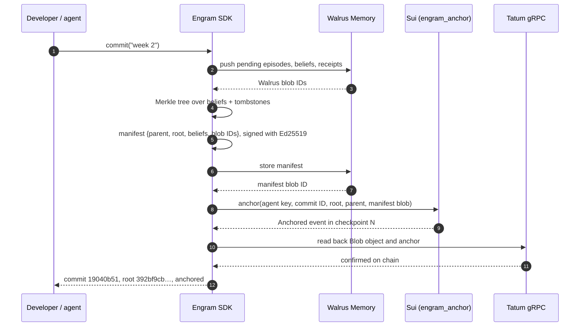
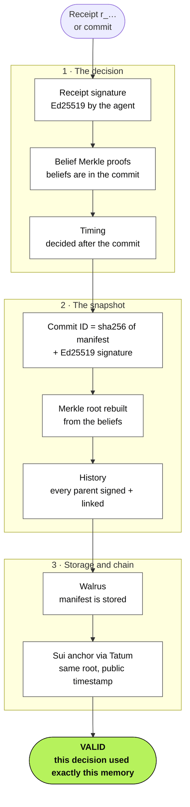

# 03: How It Works

## The big picture

### Memory lifecycle

## The five building blocks

| Block | What it is | Where it lives |
|---|---|---|
| **Episode** | Something the agent saw: a message, a wallet transaction, a tool result. Encrypted with its own key. | Walrus Memory (+ local index) |
| **Belief** | What the agent concluded, e.g. *"Rent is 520 USDC to 0x7a11 on the 1st"*. Has a version, a confidence score and links to its evidence. | Walrus Memory |
| **Commit** | A snapshot of all beliefs: Merkle root, parent commit, Ed25519 signature. | Manifest on Walrus, root anchored on Sui |
| **Receipt** | A signed record of one decision, with Merkle proofs for the beliefs it used. | Walrus Memory |
| **Tombstone** | A record that an episode was forgotten, included in the next commit. | Inside the commit |

## The main flows

### Learning: `observe` → `sleep` → `commit`
1. `observe` encrypts the episode (AES-256-GCM, new key) and stores it.
2. `sleep` sends new episodes and current beliefs to an LLM, which proposes **new**, **revised**
   or **retracted** beliefs. Every proposal must cite real episode IDs, and ungrounded ones are rejected.
3. `commit` builds a Merkle tree over the beliefs, signs the manifest, saves it on Walrus and
   anchors the root on Sui.

### Acting: `decide` / `mind.wrap()`
Before the agent acts, Engram hands it the relevant beliefs. After it acts, Engram writes a
**receipt** naming the beliefs used, with a Merkle proof for each.

### Verifying: `verify`
For a receipt or commit, Engram checks, in order:
receipt signature → belief Merkle proofs → commit ID and signature → Merkle root rebuilt →
hash-linked history → manifest on Walrus → anchor on Sui (via Tatum) → anchor time.
The result reads: *"this decision was made on this exact memory, at this time, and nothing
changed since."*

### Looking back: `log`, `diff`, `checkout`, `blame`, `bisect`
- `checkout HEAD~1` or `checkout 2026-10-20` shows what the agent believed then.
- `blame b_rent` lists the episodes (with Walrus blob IDs) behind a belief.
- `bisect` does a binary search over commits to find where a wrong belief first appeared.

### Forgetting: `forget`
Destroy the episode's key → retract beliefs that depended only on it → the next commit carries
a tombstone. The encrypted data stays on Walrus but can never be opened again.

### Linking to the dashboard: `link` → `sync`
Like `gh auth login`: the CLI shows a code, the owner approves it on the website with their
wallet, and every later commit syncs automatically. Only commits, beliefs and receipts are
uploaded, never raw episodes or keys. The server **re-verifies every upload** before showing it.

## Tech stack

| Part | Choice |
|---|---|
| Language | TypeScript, Node 20+, pnpm monorepo |
| Packages | `packages/sdk`, `packages/cli`, `apps/web`, `apps/server`, `examples/money-ops`, `contracts/engram_anchor` |
| Storage | Walrus Memory (`@mysten-incubation/memwal`) |
| Chain | Sui: `@mysten/sui`, Move module `engram_anchor`; reads via Tatum Sui gRPC |
| Crypto | `@noble/hashes`, Ed25519, AES-256-GCM. Standard primitives only. |
| LLM | Gemini (key rotation, grounded outputs) |
| Web | React + Vite + Tailwind + shadcn/ui, `@mysten/dapp-kit` for wallets |
| Tests | Vitest: SDK 62 · CLI 10 · money-ops 6 · server 20 |
