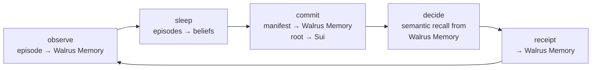
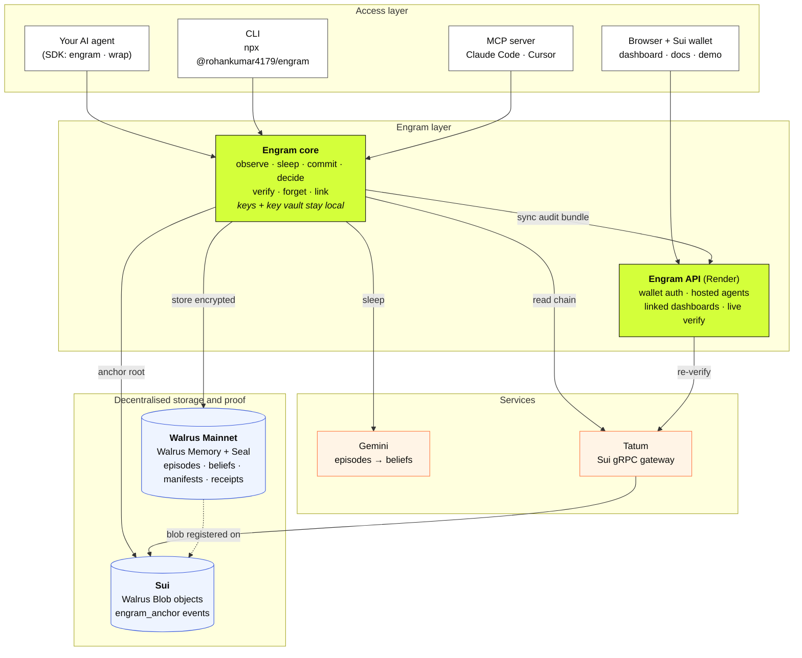
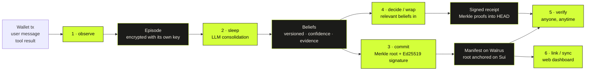
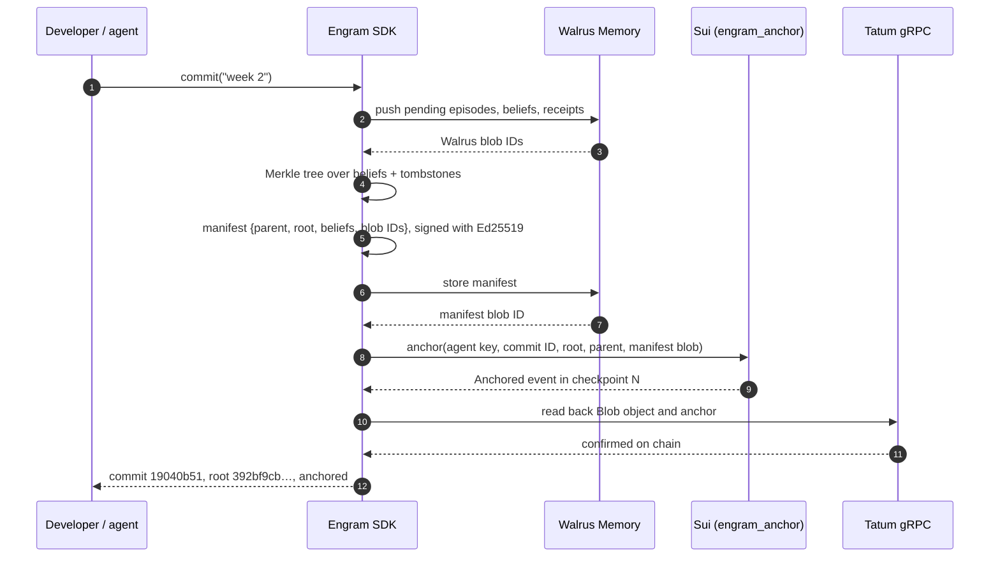
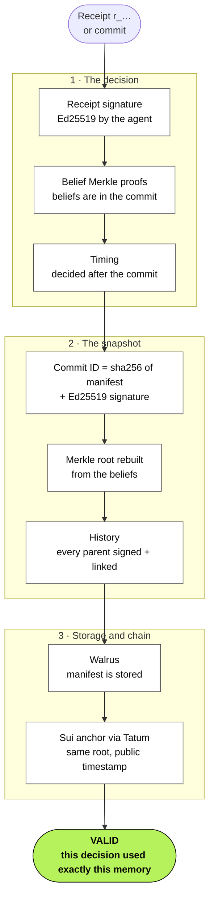
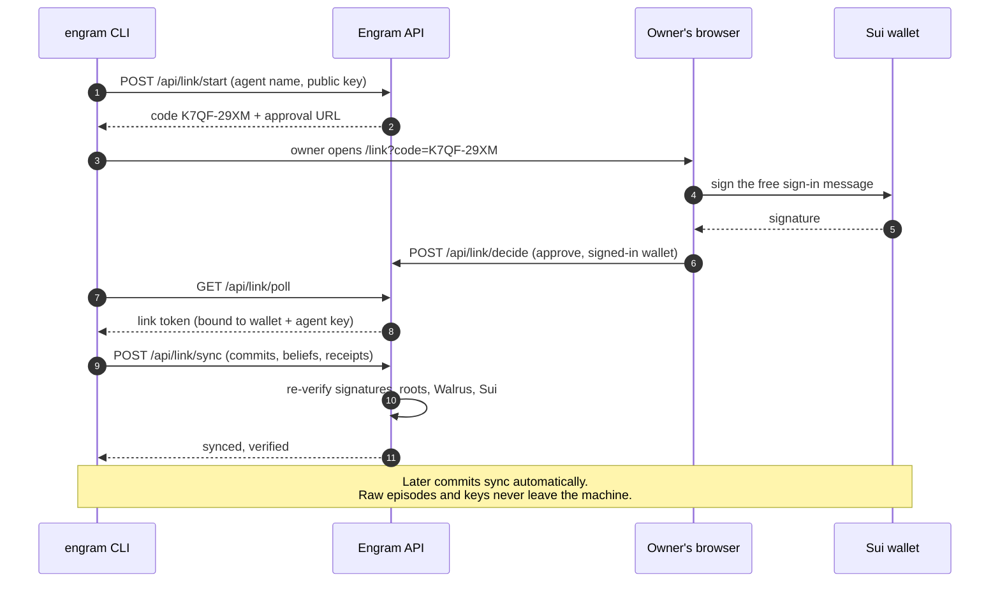
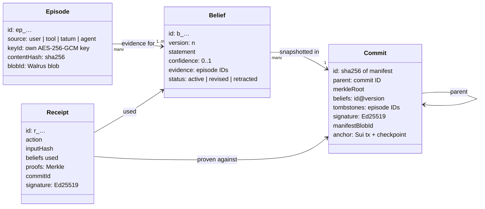
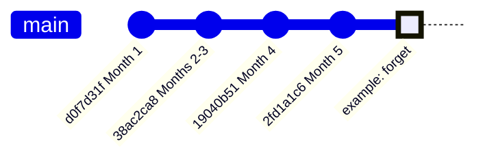
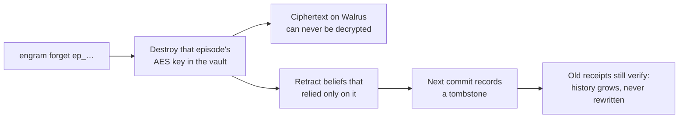

# Engram: Git for Agent Memory

> **Every belief traceable. Every decision provable. Every memory forgettable.**

Engram gives AI agents a memory that **learns**, keeps its **history**, can be **proven**, and
can be **forgotten**. It is built on [Walrus Memory](https://docs.wal.app/walrus-memory/getting-started/what-is-walrus-memory.md),
with every snapshot anchored on **Sui** and every chain read going through **[Tatum](https://tatum.io)**'s Sui gRPC gateway.

Built for the Tatum × Walrus **Total Recall** hackathon, Track 02: *Smart Agents for Real Life*.

[](https://drive.google.com/file/d/1FrONLRpjajndGVA5p4gFmyBfKeEy8jXw/view?usp=drivesdk)

**[Watch the demo video](https://drive.google.com/file/d/1FrONLRpjajndGVA5p4gFmyBfKeEy8jXw/view?usp=drivesdk)** · **[Read the blog post](https://dev.to/roan911/your-ai-agent-remembers-everything-can-it-prove-any-of-it-51og)**

| Resource | Link |
|---|---|
| Demo video | https://drive.google.com/file/d/1FrONLRpjajndGVA5p4gFmyBfKeEy8jXw/view?usp=drivesdk |
| Blog post | https://dev.to/roan911/your-ai-agent-remembers-everything-can-it-prove-any-of-it-51og |
| Live app | https://engram-blond.vercel.app |
| Live demo agent (no wallet needed) | https://engram-blond.vercel.app/demo |
| Documentation | https://engram-blond.vercel.app/docs |
| CLI | [`@rohankumar4179/engram`](https://www.npmjs.com/package/@rohankumar4179/engram): `npx @rohankumar4179/engram` |
| SDK | [`@rohankumar4179/engram-sdk`](https://www.npmjs.com/package/@rohankumar4179/engram-sdk): `npm i @rohankumar4179/engram-sdk` |
| Move contract | [`engram_anchor`](#smart-contract-engram_anchor) on Sui Testnet |
| On-chain evidence | [16 memories on Walrus Mainnet + 4 anchored commits](#on-chain-evidence-verify-it-yourself) |

---

## Contents

1. [Engram in one minute](#engram-in-one-minute)
2. [Tracks we applied for](#tracks-we-applied-for): Track 02 and Best Walrus Memory
3. [Why Walrus](#why-walrus)
4. [Architecture](#architecture): system, memory lifecycle, commit flow, verification, dashboard link, data model
5. [Smart contract: `engram_anchor`](#smart-contract-engram_anchor)
6. [On-chain evidence: verify it yourself](#on-chain-evidence-verify-it-yourself)
7. [The demo agent: money-ops](#the-demo-agent-money-ops)
8. [Use it: CLI](#use-it-cli) · [SDK](#use-it-sdk) · [MCP](#use-it-mcp) · [Web dashboard](#use-it-web-dashboard)
9. [Under the hood](#under-the-hood)
10. [Privacy, security and honest limits](#privacy-security-and-honest-limits)
11. [Run, test and deploy](#run-test-and-deploy)

---

## Engram in one minute

Agents now remember things. Once they do, new questions come up:

| Question | Engram's answer |
|---|---|
| *How did it learn?* Memories pile up as text. | **`sleep`** turns raw *episodes* into versioned *beliefs* with confidence, evidence and a reason, and revises them when facts change |
| *What did it know last week? Which memory caused this?* | **`log` · `diff` · `checkout` · `blame` · `bisect`** over the agent's mind |
| *Why did it do that, and can I trust the record?* | Every decision gets a **signed receipt** with Merkle proofs into a **commit anchored on Sui**. **`verify`** checks it end to end. |
| *Storage is permanent. How do we forget?* | **`forget`** destroys that one memory's key and records a **tombstone** in the next commit |

> **Walrus Memory gives agents memory. Engram gives that memory history, proof and control.**

---

## Tracks we applied for

| Category | Prize | Entered | In one line |
|---|---|---|---|
| **Track 02: Smart Agents for Real Life** | $1,000 track pool | ✅ Yes | An agent that watches a real wallet, learns its owner's habits, and picks up where it left off, with every decision provable |
| **Special award: Best Walrus Memory** | $500 | ✅ Yes | A learning loop you can watch, replay, diff, verify and forget, with Walrus Memory behind every layer |
| Special award: Best Use of Agent Payments | $500 | Not entered | We didn't build x402 / MPP payments. Signed receipts are the groundwork for it (see below) |
| Special award: Best Tatum AI Builder app | $500 | Not entered | Built by hand. We use Tatum's Sui gRPC gateway for every Mainnet chain read instead |

### Track 02: Smart Agents for Real Life

> *The brief: agents that watch expenses, habits and workflows, and pick up where they left off.*

The demo agent, **money-ops**, does exactly that, on real money rather than sample data:

| The brief asks for… | What Engram's agent does |
|---|---|
| **Watching expenses** | Reads its owner's real Sui wallet through **Tatum's Sui gRPC gateway**: every transfer in or out, live |
| **Learning habits** | Turns salary, rent and subscriptions into beliefs, then **stops alerting** on them (0 of 6 alerts in months 2–3) |
| **Noticing change** | Raises a WARN when the rent goes up, then **revises** its rent belief after the owner confirms it |
| **Protecting the owner** | Learns a scam address from one owner message, and raises a **CRITICAL** alert when money goes there again |
| **Picking up where it left off** | Its memory lives on Walrus and its history is committed, so after a restart it continues from its last commit |

**What makes it stand out in this track:**

- **Real transactions, not a script.** We sent real SUI between five wallets (owner, employer, landlord, streaming service, scammer). The agent never sees the script. It reads the chain like any other wallet.
- **Every decision is provable.** Each alert, and each decision *not* to alert, is a signed receipt naming the beliefs it used. Anyone can check one with [**Verify**](https://engram-blond.vercel.app/demo/receipts).
- **Anyone can run their own agent.** Sign in with a Sui wallet and get an agent that learns from *your* transactions, optionally on *your own* Walrus Memory account.
- **It's a product as well as a demo.** The CLI and SDK are on npm, there's an MCP server for Claude Code and Cursor, and there are 98 automated tests.

### Best Walrus Memory

> *The brief: "Deepest learning loop. Memories that visibly change the product."*

#### The learning loop

Most memory integrations **store and recall**. Engram's loop goes further: memories are
**consolidated, revised, versioned, proven and forgettable**, and every step is backed by Walrus Memory.



#### Memories that visibly change the product

The agent's behaviour changes because of what it remembers, and you can **see** each change:

| Period | Memory | Behaviour | Where you can see it |
|---|---|---|---|
| Month 1 | Nothing learned yet | Alerts on every payment | [Receipts](https://engram-blond.vercel.app/demo/receipts): no beliefs cited |
| Months 2–3 | 3 beliefs: salary, rent, subscription | **Quiet** on all 6 normal payments | Each receipt cites `monthly_rent@1`, `salary_payment@1`… |
| Month 4 | Rent belief **revised**; scam address **learned** | WARN on the rent change | [History](https://engram-blond.vercel.app/demo/history): the Month 4 commit shows + and ✎ changes |
| Month 5 | Remembers the scam address | **CRITICAL** on the second payment to the scammer | Receipt `r_5080ccb4…` cites `scam_address_0xcbed@1` and [verifies end to end](https://engram-blond.vercel.app/api/demo/verify/r_5080ccb4fd9c3869) |

The [**Mind**](https://engram-blond.vercel.app/demo/mind) view replays this with a time slider, so beliefs appear and revise as you drag.

#### How deeply Walrus Memory is used

| Walrus Memory feature | How Engram uses it |
|---|---|
| **Remember** | Every layer is stored: episodes, beliefs, commit manifests and receipts, each in its own namespace |
| **Semantic recall** | Picks the beliefs relevant to each decision (`mind.beliefs({ about: "rent" })`), instead of handing the agent its whole memory |
| **Seal encryption** | Memories are private to the owner. Engram adds a per-memory key on top, which makes **provable forgetting** possible |
| **Manual mode** | When the relayer's embedder went down ([MemWal#1285](https://github.com/MystenLabs/MemWal/issues/1285)), Engram fell back to local embedding + Seal, and verification kept working |
| **Delegate keys / accounts** | Users can move their agent to **their own** Walrus Memory account, set up from the browser with two wallet-signed transactions |
| **Recall for proof** | `verify` recalls each commit manifest from Walrus Memory and checks it against the root anchored on Sui |

**What makes it stand out for this award:**

| Typical memory app | Engram |
|---|---|
| Stores and recalls raw text | Consolidates text into **beliefs** with confidence and cited evidence |
| New facts pile up beside old ones | New facts **revise** beliefs (`monthly_rent` reached v5), with full history |
| You can't see what changed | `diff`, `checkout`, `blame`, `bisect` and a visual time slider |
| No link between memory and behaviour | Every decision has a **receipt** naming the exact belief versions it used |
| "Trust us, it's stored" | 16 memories on Walrus Mainnet, [each with a public blob link](#on-chain-evidence-verify-it-yourself), plus roots anchored on Sui |
| Deleting means trusting the operator | `forget` destroys the key, retracts dependent beliefs and records a tombstone |

### The awards we didn't enter

- **Best Use of Agent Payments.** Engram doesn't make x402 or MPP payments today. But a paid memory sale needs exactly what Engram already has: scoped beliefs, signed receipts and on-chain proof of what was handed over. **Paid memory sharing between agents** (MPP / x402 on Sui) is on our [roadmap](Idea/08-built-and-next.md).
- **Best Tatum AI Builder app.** We built Engram by hand rather than with ai.tatum.io. Tatum is still central to it: every Mainnet chain read goes through Tatum's Sui gRPC gateway.

---

## Why Walrus

Memory you want to **trust** shouldn't depend on trusting whoever runs the server.
Engram needs four things from its storage, and the Walrus + Sui stack provides all four:

| Engram needs… | Walrus / Sui provides… | How Engram uses it |
|---|---|---|
| Memory no single party can quietly change or delete | **Walrus**: decentralised storage across independent nodes | Episodes, beliefs, commit manifests and receipts all live on Walrus |
| A stable ID to point at in proofs | Every Walrus blob has an ID, registered as a `Blob` object on **Sui** | Commits list each episode's blob ID; `blame` shows them; `verify` checks them |
| Privacy: only the owner reads raw memories | **Walrus Memory** encrypts data for its owner (Seal) | Engram also encrypts each memory with its own key first, which is what makes provable forgetting possible |
| A public clock, so history can't be backdated | **Sui** transactions and checkpoints | The `engram_anchor` contract puts each commit's Merkle root in a public event |

And **Tatum** is how Engram reads the chain: Walrus Blob objects, anchor transactions, and
the money-ops agent's wallet activity all come through Tatum's Sui gRPC gateway.

> **Private memory, stored openly, that anyone can verify.**

---

## Architecture

### 1. System architecture

Engram runs next to your agent. The owner keeps the keys; Walrus holds the data; Sui holds the
public proof; the web app only ever sees what it can re-verify.



| Component | Role | Tech |
|---|---|---|
| **SDK / CLI / MCP** | The engine: observe, sleep, commit, decide, verify, forget | TypeScript, Node 20 |
| **Local `.engram/`** | Agent signing key, per-memory key vault, local index of commits | Ed25519, AES-256-GCM |
| **Walrus Memory** | Stores every layer, encrypted for the owner; semantic recall | `@mysten-incubation/memwal` |
| **Sui + `engram_anchor`** | Public, timestamped Merkle roots; Walrus Blob objects | Move |
| **Tatum** | Every Mainnet chain read: Blob objects, anchors, wallet activity | Sui gRPC gateway |
| **Gemini** | Turns episodes into beliefs during `sleep` | Grounded JSON output |
| **Web app + API** | Wallet sign-in, hosted agents, linked dashboards, live verify | React, Vite, Node, Docker |

### 2. Memory lifecycle

How a raw event becomes a provable decision.



| Step | Command | What happens |
|---|---|---|
| 1 | `observe` | Records an episode, encrypted with a fresh AES-256-GCM key |
| 2 | `sleep` | The LLM proposes new / revised / retracted beliefs. Each must cite real episode IDs, and the rest are rejected. |
| 3 | `commit` | Pushes to Walrus Memory, builds the Merkle root, signs the manifest, stores it on Walrus, anchors it on Sui |
| 4 | `decide` / `mind.wrap()` | Gives the agent its relevant beliefs and writes a signed receipt naming the ones it used |
| 5 | `verify` | Re-checks everything, down to the anchor on Sui |
| 6 | `link` → `sync` | Shows the agent on your dashboard. Only commits, beliefs and receipts leave your machine. |

Also: `diff` (what changed), `checkout` (memory at any commit or date), `blame` (evidence behind a
belief), `bisect` (find where it learned something wrong), `forget` (provable forgetting).

### 3. Commit flow

What happens during `engram commit`, step by step.



### 4. Verification pipeline

`engram verify` and the **Verify** button run the same checks. Any failure makes the result INVALID.



### 5. Linking an agent to the dashboard

Works like `gh auth login`: a one-time code, approved with the owner's wallet.



### 6. Data model



### 7. History and forgetting

Commits form a hash-linked chain, like git. Forgetting doesn't rewrite history: it adds a
tombstone to the next commit, so old receipts still verify. The first four commits are the
real demo history; the last one shows what a `forget` would add.





---

## Smart contract: `engram_anchor`

A small Move module that makes each commit's Merkle root **public on Sui**. It emits one event and
creates no objects, so anchoring costs only gas.

| | |
|---|---|
| Source | [`contracts/engram_anchor/sources/anchor.move`](contracts/engram_anchor/sources/anchor.move) |
| Network | Sui **Testnet** |
| Package ID | [`0xa1fccbb3e282e4ca09efbb2a46b3584d038fd154b9f9db36fc8d60d9051bf86b`](https://suiscan.xyz/testnet/object/0xa1fccbb3e282e4ca09efbb2a46b3584d038fd154b9f9db36fc8d60d9051bf86b) |
| Entry function | `engram_anchor::anchor::anchor(agent_pubkey, commit_id, merkle_root, parent, manifest_blob, clock)` |
| Event | `Anchored { sender, agent_pubkey, commit_id, merkle_root, parent, manifest_blob, timestamp_ms }` |
| Checks | `commit_id` and `merkle_root` must be 32 bytes; `parent` is empty or 32 bytes |

`verify` reads the event back (Mainnet through Tatum, Testnet through the public Sui node) and
compares the commit ID, Merkle root and agent key with the local commit.
Deploy your own copy with `npx tsx packages/sdk/scripts/publish-anchor.ts testnet|mainnet`.

---

## On-chain evidence: verify it yourself

Everything below comes from the public demo agent ([live](https://engram-blond.vercel.app/demo)),
a wallet-watching agent that ran on **real transfers**. Every link was checked before publishing:
all 20 blobs answer `200` on the Walrus Mainnet aggregator, and all 4 anchor transactions are
`SUCCESS` on Sui Testnet.

### 16 memories stored on Walrus Mainnet

Each memory is encrypted, so the explorer shows that the blob exists, not what it says.

| # | Episode | Source | What the agent saw | Walrus blob |
|---|---|---|---|---|
| 1 | `ep_cc0d45adf1f1` | wallet | received 0.21 SUI (salary) | [VxuTjRq1…](https://walruscan.com/mainnet/blob/VxuTjRq1omsMDxPAkhERZfWu316fFf9WyU7cdB_7FI8) |
| 2 | `ep_0cb78befdd56` | wallet | sent 0.045 SUI (rent) | [1NMnZMpH…](https://walruscan.com/mainnet/blob/1NMnZMpHMg3Sk62YxDLoEqNIdDmJ6GG0peiH7UP8YNw) |
| 3 | `ep_01f7d6c29733` | wallet | sent 0.0012 SUI (subscription) | [Ir81SYv_…](https://walruscan.com/mainnet/blob/Ir81SYv_07But9A-pL3FlAHDKvjLmYP3lRF1XSAxDbg) |
| 4 | `ep_13b73f5ef8cd` | owner | owner explains the payments | [CzNO7jdU…](https://walruscan.com/mainnet/blob/CzNO7jdUWjJFUhckgQyk1VsGQ3ChWfYuKHtf7uLFj6E) |
| 5 | `ep_af9413395324` | wallet | received 0.21 SUI (salary) | [CzSavpsI…](https://walruscan.com/mainnet/blob/CzSavpsIOVqw1IIJWDel05Zu0VI555VAah7iYnyBCa4) |
| 6 | `ep_82aab6fd6729` | wallet | sent 0.045 SUI (rent) | [h-rc9I_z…](https://walruscan.com/mainnet/blob/h-rc9I_zt94LAjhelrp2jF-yx9HQI2mcHBk9rIQa2yo) |
| 7 | `ep_aad55edab554` | wallet | sent 0.0012 SUI (subscription) | [343C4Ofi…](https://walruscan.com/mainnet/blob/343C4Ofi66OCgcPFPXBUcAvf8LiMeNiluN-okDRLEPY) |
| 8 | `ep_d9dec06e5d38` | wallet | received 0.21 SUI (salary) | [5xWXlpX5…](https://walruscan.com/mainnet/blob/5xWXlpX5bmuYbOZzCbsrt6RpDOHLJeiFLiRWqxIkgLg) |
| 9 | `ep_53641e89c8dd` | wallet | sent 0.045 SUI (rent) | [oodGFYPP…](https://walruscan.com/mainnet/blob/oodGFYPPj-YZ1aJl2smMsP_NbJ_EE6eYRoW0GtqTE6E) |
| 10 | `ep_1beabf33f70b` | wallet | sent 0.0012 SUI (subscription) | [kBAbky77…](https://walruscan.com/mainnet/blob/kBAbky77FwoyFj6ARskJEurjKMd3SgvOB3Lc4Z1jibk) |
| 11 | `ep_ae891c285fa0` | wallet | sent 0.05 SUI (rent went up) | [nZGOp4Ps…](https://walruscan.com/mainnet/blob/nZGOp4PsgXIgmcFEuLXbwLiKdoBQzfavwqbmj0jDN6g) |
| 12 | `ep_d294c4555005` | owner | owner confirms the rent rise | [K-3IQ5g-…](https://walruscan.com/mainnet/blob/K-3IQ5g-JcA693N9yyYz2VBBIYjAwkIsYbmNLwuV3Y8) |
| 13 | `ep_ea7c580e0aca` | wallet | sent 0.18 SUI to an unknown address | [dIdDTSWq…](https://walruscan.com/mainnet/blob/dIdDTSWqtYfvVoO_7vlJRoPlGYk4qHOROD_9W5vtn80) |
| 14 | `ep_3dfd7c7c2de8` | owner | "that's a scammer" | [EMM5aLlV…](https://walruscan.com/mainnet/blob/EMM5aLlVfmzP9nl6ENgqY02lHBQ3sYTZ0CbaNJ00DnI) |
| 15 | `ep_1acc5a79f8b3` | wallet | sent 0.05 SUI (new rent) | [KnJepE5e…](https://walruscan.com/mainnet/blob/KnJepE5ekRIabA0nHctrMwD61eoR7ju_XLgnXWi1HH0) |
| 16 | `ep_f66b0d7b5c00` | wallet | sent 0.025 SUI to the scammer → **CRITICAL alert** | [FC-92hYt…](https://walruscan.com/mainnet/blob/FC-92hYt6rX2P8oJy-pvKRMbOAW0g3V2DranpmQx-Ss) |

### 4 commits: manifest on Walrus, Merkle root anchored on Sui

| Commit | Message | Manifest on Walrus | `Anchored` tx on Sui Testnet | Checkpoint |
|---|---|---|---|---|
| `d0f7d31f` | Month 1: salary, rent, subscription | [qJnLv3IR…](https://walruscan.com/mainnet/blob/qJnLv3IRt9JkxLLShObFWaGxj6FT3ID2acRwX374x2U) | [GRNWPaGF…](https://suiscan.xyz/testnet/tx/GRNWPaGFF4H5gAtKiGV8c6TRdiTHX4roNUeRQWVWa6Xt) | 397,920,256 |
| `38ac2ca8` | Months 2–3: habits confirmed | [PAzxBnKi…](https://walruscan.com/mainnet/blob/PAzxBnKinLL60UemEVHu8Kc79mpu-irOd-pyJ_LJZso) | [fJFh8kVe…](https://suiscan.xyz/testnet/tx/fJFh8kVer4VNWYyKqVns974Mk2Xf35d4oS6XDr8getE) | 397,921,635 |
| `19040b51` | Month 4: rent change + scam address | [YI30MCNa…](https://walruscan.com/mainnet/blob/YI30MCNaOGF-IrJmHcI_dIFdGuHj0YstRQmdW8oEVtM) | [BPFs7Eqa…](https://suiscan.xyz/testnet/tx/BPFs7EqazA9nxUtr5rGnjcAJb4eUqxsNTUcA2L5aT4yx) | 397,926,925 |
| `2fd1a1c6` | Month 5: applying what it learned | [SmglWW_s…](https://walruscan.com/mainnet/blob/SmglWW_swvwclEXSYpUsrPJGICPPprw91mjP8JXU8-0) | [ArLtGfg5…](https://suiscan.xyz/testnet/tx/ArLtGfg5ChjDFJHrAZzgWiqv2WMrDjhG1tfin868Z1vb) | 397,927,899 |

### One decision, proven end to end

Receipt **`r_5080ccb4fd9c3869`**: the agent's CRITICAL alert when the owner's wallet paid the scammer.
Live result from the server (also the **Verify** button at [/demo → Receipts](https://engram-blond.vercel.app/demo/receipts)):

```
✔ receipt signature    "ALERT[critical]: sent 0.025 SUI to 0xcbed89… — Outgoing transfer detected
                        to a known scam address representing theft." signed by the agent
✔ belief proofs        2 belief(s) proven to be in commit 19040b51
✔ timing               decision made after its commit
✔ commit id            sha256 of the manifest matches the commit ID
✔ commit signature     Ed25519 by agent 0e648084a79c…
✔ commit merkle root   5 beliefs + 0 tombstones → root 392bf9cbb518…
✔ commit history       2 earlier commit(s), all signed and hash-linked
✔ commit walrus        manifest recalled from Walrus Memory, blob YI30MCNaOG…
✔ commit sui anchor    Anchored event: root 392bf9cbb5… public in checkpoint 397926925 (testnet)
✔ commit anchored at   2026-10-22T14:35:05.365Z
VALID
```

### Check it without trusting us

```bash
# 1. A memory blob is stored on Walrus Mainnet (HTTP 200; the content is encrypted)
curl -I https://aggregator.walrus-mainnet.walrus.space/v1/blobs/FC-92hYt6rX2P8oJy-pvKRMbOAW0g3V2DranpmQx-Ss

# 2. The Merkle root of commit 19040b51 is public on Sui (base64 of 392bf9cb…)
curl -s https://graphql.testnet.sui.io/graphql -H 'content-type: application/json' \
  -d '{"query":"{ transaction(digest: \"BPFs7EqazA9nxUtr5rGnjcAJb4eUqxsNTUcA2L5aT4yx\") { effects { events { nodes { contents { json } } } } } }"}'

# 3. The full proof check, through the live API
curl -s https://engram-blond.vercel.app/api/demo/verify/r_5080ccb4fd9c3869
```

---

## The demo agent: money-ops

`examples/money-ops` watches a Sui wallet, learns its owner's habits, and decides whether each
movement deserves an alert. Every decision is a signed receipt.

**The story uses real transactions.** `money-ops live` creates five wallets (owner, employer,
landlord, streaming service, scammer) and sends real SUI between them: salary in, rent and a
subscription out, a rent rise, and a staged theft. The agent never sees the script. It reads
the owner's wallet from the chain like any other wallet.

| Phase | On chain | What the agent does |
|---|---|---|
| Month 1 | Salary in; rent and subscription out. The owner explains them | 3 / 3 alerted, then learns 3 beliefs |
| Months 2–3 | The same six transfers again | **0 / 6 alerted**; each receipt cites the belief it used |
| Month 4 | Rent rises; 0.18 SUI goes to an unknown address. The owner: "that's a scammer" | Revises rent, learns the scam address |
| Month 5 | New rent; another payment to the scammer | Quiet on rent, **CRITICAL** on the scammer, from memory |

```bash
pnpm --filter @engram/money-ops live --network testnet --fund-from-env   # real transfers on Testnet
pnpm --filter @engram/money-ops live --network mainnet                   # same on Mainnet
pnpm --filter @engram/money-ops watch 0x<address>                        # any real wallet, live via Tatum
pnpm --filter @engram/money-ops replay --offline                         # scripted, no chain (tests)
```

The theft is staged (the owner's own key signs it), but it is an ordinary on-chain transfer.
The whole story moves about 0.75 SUI.

---

## Use it: CLI

Needs Node 20+ and a `.env` with your keys (see [Configuration](https://engram-blond.vercel.app/docs#configuration)).
On Windows PowerShell, use `npx.cmd`.

```bash
npx @rohankumar4179/engram init my-agent
npx @rohankumar4179/engram observe "I pay 450 USDC rent to 0x7a11 on the 1st"
npx @rohankumar4179/engram sleep                   # episodes → beliefs
npx @rohankumar4179/engram commit -m "first week"  # signed → Walrus → Sui
npx @rohankumar4179/engram verify                  # ✔ … VALID
```

| Command | What it does |
|---|---|
| `init <agent>` | Creates `.engram/`: Ed25519 agent key, key vault, Walrus Memory namespaces; checks Tatum |
| `observe [data]` | Records an episode, encrypted with its own AES-256-GCM key (`-s` source, `-m` summary, `-f` file) |
| `sleep` | LLM consolidation: create / revise / retract beliefs, grounded in episode IDs |
| `commit -m <msg>` | Walrus Memory push → Merkle root → signed manifest on Walrus → Sui anchor |
| `decide <action> -u <belief…>` | Signed decision receipt with Merkle proofs *(in the repo; next npm release)* |
| `status` · `beliefs` · `receipts` | Where the agent is now |
| `log` · `diff` · `checkout` | History, belief diffs, the memory at any commit, `HEAD~n` or date |
| `blame <belief>` | The episodes (with Walrus blob IDs) and version history behind a belief |
| `bisect <good> <bad>` | Binary search for the commit that broke the agent (`--grep` or `--ask`) |
| `verify [r_…\|commit]` | Full proof check: signatures, Merkle proofs, hash chain, Walrus, Sui |
| `forget <episode>` | Destroys the key, retracts what depended on it, tombstones the next commit |
| `export --audit` · `audit <file>` | A bundle anyone can verify without the repo, including Sui anchors |
| `link` · `sync` · `unlink` | Connect to the web dashboard with your Sui wallet |
| `ui` | Local inspector: belief graph with time slider, history, receipts, live verify |
| `mcp` | Run as an MCP server |

## Use it: SDK

```ts
import { engram } from "@rohankumar4179/engram-sdk";

const mind = engram({ agent: "money-ops" });       // Walrus Memory, Tatum, Gemini from .env

// Wrap your existing agent: relevant committed beliefs in, a signed receipt out.
const agent = mind.wrap(async (tx, beliefs) => myAgent.decide(tx, beliefs), {
  used: (decision) => decision.beliefIds,
});
const decision = await agent(tx);
agent.lastReceipt;                                 // r_… with Merkle proofs into HEAD

mind.observe({ source: "tatum", data: tx });       // encrypted episode
await mind.sleep();                                // consolidate → beliefs
await mind.commit("weekly");                       // prove (+ dashboard sync if linked)
await mind.beliefs({ about: "rent" });             // Walrus Memory semantic recall
mind.at("2026-10-01");                             // time travel
mind.forget("ep_…");                               // provable forgetting
await mind.verify(agent.lastReceipt!.id);          // signature → proofs → Walrus → Sui

// Link to the dashboard from code
await mind.link({ server: "https://engram-blond.vercel.app", onCode: ({ url, code }) => console.log(code, url) });
```

## Use it: MCP

For Claude Code, Cursor and Claude Desktop:

```json
{ "mcpServers": { "engram": { "command": "npx", "args": ["@rohankumar4179/engram", "mcp", "-C", "/path/to/agent"] } } }
```

| Tool | Does |
|---|---|
| `engram_remember` | Record an episode |
| `engram_beliefs` | Beliefs by topic, or at a past commit |
| `engram_sleep` · `engram_commit` | Learn and checkpoint |
| `engram_log` · `engram_diff` · `engram_blame` | History and evidence |
| `engram_forget` · `engram_verify` · `engram_status` | Forget, prove, inspect |

## Use it: Web dashboard

- **Sign in** with any Sui wallet. It's one free text signature, never a transaction.
- **Your agent:** a hosted agent that reads your wallet through Tatum and learns from what you tell it.
  It can move to **your own Walrus Memory account** with two wallet-signed transactions.
- **Your agents:** CLI/SDK agents you linked:

```bash
$ npx @rohankumar4179/engram link --server https://engram-blond.vercel.app
  Open https://engram-blond.vercel.app/link?code=K7QF-29XM
  and approve code K7QF-29XM with your Sui wallet.
✔ linked to wallet 0xfe2cfd89…7b46
✔ synced 2 commits and 0 receipts — verified by the server
```

Every later commit syncs automatically. Only the audit bundle is uploaded (commits, beliefs,
receipts), never raw episodes or keys. The server **re-verifies every sync** (signatures, Merkle
roots, Sui anchors, manifests on Walrus) before showing it. A link token only accepts bundles
signed by that agent's key, and history can only grow.

---

## Under the hood

- **Merkle leaves** commit to belief ID, version, statement hash, confidence, evidence root and
  tags, with domain-separated hashing (leaf `0x00`, node `0x01`). Tombstones are leaves too.
- **Two anchors per commit.** (1) Every Walrus Memory write registers a Walrus `Blob` object on Sui;
  Engram finds the manifest's Blob object and its certifying transaction through Tatum.
  (2) The `engram_anchor` event puts the Merkle root itself on chain in the clear.
- **Tatum over gRPC.** Sui switched JSON-RPC off in July 2026, so every Mainnet chain read
  (wallet feed, Walrus Blob objects, anchor events) uses Tatum's Sui gRPC gateway
  (`sui-mainnet-grpc.gateway.tatum.io`) with native gRPC. The wallet feed uses one
  `affectedAddress` query, so it sees money sent *and* received.
- **Walrus Memory fallback.** If the relayer's server-side embedding fails (as on 22 Oct,
  [MemWal#1285](https://github.com/MystenLabs/MemWal/issues/1285)), Engram switches to manual mode:
  it embeds locally, Seal-encrypts with the owner's key, and the relayer stores only ciphertext +
  vector. Recall merges both paths, so `verify` keeps working.
- **Grounded consolidation.** Evidence must be real episode IDs, and edits must target existing
  beliefs. Rejected proposals get one repair round with the reason.
- **Dashboard verification without the owner's key.** The server can't read an owner's encrypted
  manifest, so it confirms the blob on Walrus through the public aggregator and checks the
  content through the Merkle root on Sui.
- **Restart-safe sessions.** Sign-ins and link tokens are HMAC-signed, so they keep working after
  the server restarts.

```
packages/sdk        @rohankumar4179/engram-sdk: core library
packages/cli        @rohankumar4179/engram: CLI + MCP server
apps/web            web app (React, Vite, Tailwind, shadcn/ui, React Flow, dapp-kit)
apps/server         API server: wallet auth, hosted agents, link flow, live verify
examples/money-ops  wallet-watching agent (Tatum feed, real-transaction story)
contracts/          engram_anchor Move package
docs/blog/          screenshots used by the README and blog.md
Idea/               product write-up for judges
```

---

## Privacy, security and honest limits

| Stays with the owner | Goes to Walrus | Goes to Sui | Goes to the dashboard |
|---|---|---|---|
| Agent key, key vault, decrypted memories | Encrypted episodes, beliefs, manifests, receipts | Blob certification, `Anchored` events | Commits, beliefs, receipts, re-verified |

- Standard primitives only: SHA-256, Ed25519, AES-256-GCM, Merkle trees.
- **Forgetting** makes an episode unreadable to anyone holding only the ciphertext. It can't
  un-read copies already decrypted, and belief *summaries* that cited it stay in history,
  marked as retracted.
- **Manifests are Seal-encrypted** for the owner by Walrus Memory. Third parties confirm the blob on
  Walrus and the content via the public Merkle root on Sui.
- **The Move anchor runs on Sui Testnet** today. Walrus memories and Tatum reads are on Mainnet.
- **Keys** (`agent.key`, `master.key`) live in `.engram/` on disk today; KMS or Seal is planned.

---

## Run, test and deploy

```bash
pnpm install && pnpm build
cp .env.example .env              # Walrus Memory, Tatum, Gemini keys
pnpm -r test                      # SDK 62 · CLI 10 · money-ops 6 · server 20
cd apps/server && npx tsx src/main.ts   # API + web app on http://localhost:8787
```

**Frontend (Vercel):** the root `vercel.json` builds `apps/web` and rewrites `/api/*` to the backend.

**Backend (Render, Docker):** `render.yaml` + `Dockerfile`. Environment variables:

| Var | What it is |
|---|---|
| `TATUM_API_KEY_MAINNET` | Tatum API key (Sui gRPC) |
| `MEMWAL_KEY` · `MEMWAL_ACCOUNT_ID` | Walrus Memory account owner key and account object ID |
| `SUI_MNEMONIC` | Wallet that pays gas for Move anchors |
| `GEMINI_API_KEYS` · `GEMINI_MODEL` | LLM for `sleep` |
| `ENGRAM_ANCHOR_PACKAGE` · `ENGRAM_ANCHOR_NETWORK` | `engram_anchor` package ID and network |
| `ENGRAM_PUBLIC_URL` | Public URL of the web app, used for `/link?code=…` approval links |
| `ENGRAM_SECRET` *(optional)* | Key for signing sessions and link tokens (otherwise derived from an existing secret) |

The `apps/server/demo-agent/` folder ships in the image as the read-only public demo (no keys inside).

## Built with

Walrus Memory (`@mysten-incubation/memwal`) · Tatum Sui gRPC · Sui + Move · Gemini ·
`@noble/hashes`, `@noble/curves` · React, shadcn/ui, React Flow, Tailwind CSS.

MIT licensed.
