# Your AI agent remembers everything. Can it prove any of it?

### Building Engram: git for agent memory, on Walrus, Sui and Tatum

*By Rohan · Tatum × Walrus **Total Recall** hackathon · Track 02: Smart Agents for Real Life*


> **Every belief traceable. Every decision provable. Every memory forgettable.**

[**Watch the demo video**](https://drive.google.com/file/d/1FrONLRpjajndGVA5p4gFmyBfKeEy8jXw/view?usp=drivesdk) · [**Try the live agent, no wallet needed**](https://engram-blond.vercel.app/demo) · [**Read the docs**](https://engram-blond.vercel.app/docs) · [**Read the code**](https://github.com/rohan911438/Engram)

> **The short version.** AI agents now remember things about us, and they act on what they
> remember. But nobody can see *how* an agent learned something, *which* memory drove a
> decision, whether the record was edited afterwards, or how to make it truly forget.
> **Engram** fixes that. It gives an agent's memory a **history** (like git), a **proof** that
> anyone can check (signed snapshots stored on Walrus and anchored on Sui), and an **off switch**
> (forgetting you can prove). It's live, it's on npm, and the demo agent learned from real
> on-chain transactions.

***

## Part 1 · The moment that started it

Picture this. You've given an AI agent access to your wallet. Its job is simple: watch your
money and warn you when something looks wrong. For weeks it does fine. It learns your salary,
your rent and your subscriptions, and it stops bothering you about them.

Then one morning it stays quiet about a payment to an address you've never seen.

You ask it a simple question: **"Why didn't you warn me?"**

And it can't really answer.

It has *memories*, a growing pile of text it has collected over the weeks. But it can't show
you:

- **which** of those memories it relied on,
- **what** it believed at the exact moment it decided,
- **when** it started believing that, or what taught it,
- or any proof that the record you're looking at is the same one it used. The logs sit on
  the operator's server, and anyone with access could have changed them afterwards.

That's where agent memory is today. Tools like **Walrus Memory** have made it easy for agents
to remember. Nobody had made it easy to **hold that memory to account**.

We kept coming back to one thought: software developers had this exact problem decades ago,
with code. Code changed constantly, many people touched it, and when something broke, nobody
knew which change caused it. The answer was **version control**. Every change became a commit,
history could be compared, and `git blame` could tell you exactly where any line came from.

We wanted that for an agent's mind, plus one thing git never needed: **proof that a stranger
can check without trusting us.**

So we built **Engram**. The name comes from neuroscience, where an *engram* is the physical
trace a memory leaves in the brain.

***

## Part 2 · Why we felt we had to build it

#### Agents crossed a line this year

For a long time, AI assistants mostly *talked*. If one misremembered something, you got a
wrong answer, you noticed, and you moved on.

That's changing quickly. Agents now **act**. They move money, approve refunds, triage support
tickets, screen applicants and manage on-chain treasuries. And to act well, they need memory:
your preferences, your habits, the context from last week.

Once an agent acts for you, its memory stops being a convenience and becomes a
**responsibility**. A wrong memory is no longer a wrong sentence. It's a wrong payment, a wrong
refund, a wrong rejection.

#### Five questions nobody could answer

While building and using agents, we kept hitting the same five questions:

| The question | What you get today | What you'd actually want |
|---|---|---|
| **"How did it learn that?"** | A pile of raw text snippets | A clear line from *what it saw* to *what it concluded*, and how that changed over time |
| **"Why did it do that?"** | A decision with no trail | A record of exactly which knowledge each decision used |
| **"Can I trust this record?"** | Logs on the operator's server | Evidence that can't be quietly edited, checkable by anyone |
| **"What went wrong, and when?"** | Guesswork | A way to search history for the moment a bad belief appeared |
| **"Can it forget?"** | "We deleted it, trust us" | Forgetting you can *prove*, without breaking the rest of the record |

#### Why existing tools don't solve this

We looked hard at what already exists before building anything.

- **Vector databases and memory stores** are good at *remembering*. But they're a current
  snapshot. They don't keep history, so you can't ask "what did you believe last Tuesday?"
- **Logging and observability tools** record what an agent *did*. They don't record what it
  *believed*, and the logs belong to the operator, the very party you might need to audit.
- **Blockchains** give you a public, tamper-proof clock. But you can't put private memories on
  a public chain.

Each tool solves one piece. None of them connects *what an agent saw* → *what it concluded* →
*what it did* in a way that is private, versioned and provable at the same time.

#### The idea, in one sentence

> **Treat an agent's mind like a git repository, and make every commit provable on a public chain.**

We didn't want to replace Walrus Memory. It already stores agent memory privately and in a
decentralised way. We wanted to build the layer that was missing **on top of it**:

> **Walrus Memory gives agents memory. Engram gives that memory history, proof and control.**

***

## Part 3 · Who it's for

Engram is for anyone who might one day have to answer **"why did the agent do that?"** with
evidence instead of a shrug.

| Who | The question they're stuck on | What Engram gives them |
|---|---|---|
| **Agent developers** | "My agent got worse after last week. What did it learn?" | `log`, `diff`, `checkout`, `blame` and `bisect` on the agent's mind |
| **On-chain and fintech agents** (wallet watchers, treasury bots, payment agents) | "Why did the agent move, or block, this money?" | A signed receipt for every decision, which anyone can `verify` |
| **Regulated teams** (finance, health, insurance, HR) | "Can we show which knowledge an automated decision relied on?" | Tamper-evident history and audit bundles that outsiders can check |
| **Privacy-first apps** | "The user asked us to delete their data. Can we prove we did?" | `forget`, which destroys the data's key and records it in history |
| **Everyday assistant users** (through MCP) | "What do you know about me? Forget that." | Engram tools inside Claude Code, Cursor and Claude Desktop |

#### Four stories that show why it matters

***The wallet agent (our demo).*** An agent watches a Sui wallet through Tatum. It learns the
owner's salary, rent and subscriptions, and stops alerting on normal payments. When money goes
to an address the owner flagged as a scammer, it raises a **CRITICAL** alert. That one decision
can be verified end to end, down to a public timestamp on Sui.

***The support bot that went rogue.*** After an update, a support bot starts approving refunds
it shouldn't. Instead of reading thousands of logs, the developer runs `bisect`, and it finds
the exact commit where the bot learned *"refunds are allowed up to 60 days"* from one misread
ticket. `blame` shows that ticket. `forget` removes it, and the next commit fixes the belief.

***The trading dispute.*** A user says a trading bot made a trade "for no reason." The operator
doesn't argue. They send the receipt for that trade, and the user runs `verify` on their own
machine. It shows exactly which beliefs the bot used and proves they existed *before* the trade.

***The right to be forgotten.*** A patient asks a health assistant to delete a conversation.
After `forget`, the data can never be decrypted again, and the agent's own history shows the
memory was removed and when.

#### Who doesn't need it

If you're building a simple chatbot with no need for history, audits or debugging, plain
Walrus Memory is enough. And if your data must be edited in place, Engram isn't a fit, because
it's append-only by design. That's what makes it trustworthy.

***

## Part 4 · The ideas, in plain language

Engram borrows from two places: **how people remember** and **how git tracks code**. Here are
the five building blocks.

#### Episode: what the agent saw

An **episode** is a raw experience. It could be a wallet transaction (*"sent 0.05 SUI to
0x2498…"*), something the owner said (*"that's my rent"*), or a tool result. Each episode is
encrypted with **its own key** before it's stored. That detail matters later, when we get to
forgetting.

#### Belief: what the agent concluded

A **belief** is a short statement the agent holds to be true, such as *"The owner pays 0.05 SUI
rent to 0x2498… once a month."* Each belief has:

- a **confidence** score from 0 to 1,
- **evidence**: the exact episodes that support it,
- a **version** number, because beliefs change when the facts do,
- a **status**: active, revised or retracted.

#### Sleep: how episodes become beliefs

People don't remember every moment of their day. While we sleep, the brain turns experiences
into knowledge. Engram does something similar. The `sleep` step hands new episodes and current
beliefs to an LLM, which proposes **new**, **revised** or **retracted** beliefs.

There's one strict rule: **every proposal must cite real episode IDs.** If the model invents a
reason or points at evidence that doesn't exist, the proposal is rejected. The agent can't
make up why it believes something.

#### Commit: a snapshot of the mind

A **commit** freezes every active belief into one snapshot. All the beliefs are combined into
a single fingerprint called a **Merkle root**: change any belief, even by one character, and
the fingerprint no longer matches. The snapshot is signed with the agent's own key, stored on
Walrus, and its fingerprint is published on Sui. Each commit names its parent, so history forms
a chain that can't be rewritten without breaking every link after it.

#### Receipt: proof of *why*

Every time the agent makes a decision, Engram writes a **receipt**: *"I did X, using exactly
these beliefs, from this snapshot."* The receipt is signed and includes a small mathematical
proof (a **Merkle proof**) for each belief, showing it was part of the snapshot **without
revealing any of the other beliefs**.

#### How they connect

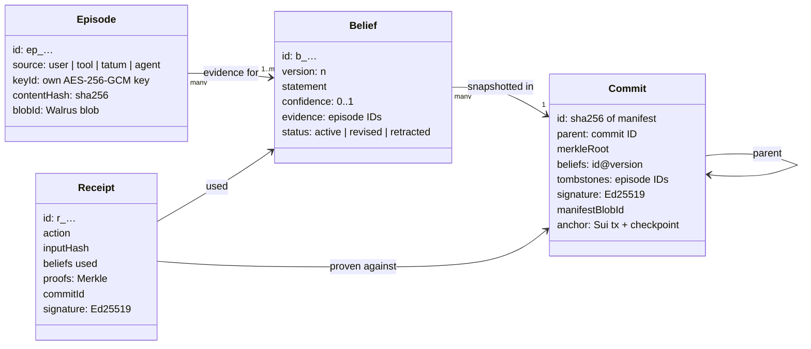

Episodes are evidence for beliefs. Beliefs are snapshotted in commits. Commits link to their
parents. Receipts point at the commit and the beliefs they used. Follow the arrows and you can
walk from any decision back to the raw experiences behind it.

***

## Part 5 · The life of one memory

The easiest way to understand Engram is to follow a single memory from start to finish. Let's
follow the rent payment from our demo.

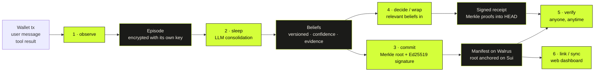

#### Step 1 · observe: the agent sees something

0.045 SUI leaves the owner's wallet. The agent reads it from the chain through Tatum, and
`observe` turns it into an episode. Engram generates a fresh AES-256-GCM key for this one
episode, encrypts it, and stores the ciphertext on Walrus. The owner also says *"that's my
rent"*, which becomes a second episode.

#### Step 2 · sleep: it draws a conclusion

`sleep` reads the new episodes and proposes a belief: *"The owner pays 0.045 SUI rent to
0x2498… monthly"*, citing both episodes as evidence. Engram checks that both episode IDs are
real before accepting it.

#### Step 3 · commit: it locks in what it knows

`commit` builds the Merkle root over every active belief, signs the snapshot with the agent's
Ed25519 key, stores it on Walrus, and publishes the root on Sui through our Move contract. From
this moment, there's a public, timestamped record of what this agent believed.

#### Step 4 · decide: it acts, and leaves a receipt

Next month, the same rent payment arrives. Before deciding, Engram hands the agent only the
relevant beliefs (found through Walrus Memory's semantic recall). The agent stays quiet,
because this is normal, and Engram writes a signed receipt: *"No alert, because of belief
`monthly_rent@1`, from commit `d0f7d31f`."*

#### Step 5 · revise: the facts change

In month four, the rent goes up to 0.05 SUI. The agent raises a **WARN**, because this doesn't
match what it knows, and the owner confirms the rise. At the next `sleep`, the belief isn't
duplicated. It's **revised**: version 2 replaces version 1, and both stay in history.

#### Step 6 · verify: anyone can check

Months later, anyone holding a receipt can run `verify`. Engram checks the signature, the
proofs, the snapshot, the history, the copy on Walrus and the anchor on Sui. If everything
matches, the answer is **VALID**: *this decision was made on this exact memory, at this time,
and nothing has changed since.*

#### And if it ever needs to forget

If the owner asks to forget that first rent message, `forget` destroys its key, retracts any
belief that relied only on it, and records a **tombstone** in the next commit. More on that in
Part 8.

***

## Part 6 · The architecture

Engram follows one rule: **the owner keeps the keys, Walrus keeps the data, Sui keeps the
proof.** Even our own website only shows what it can re-check for itself.

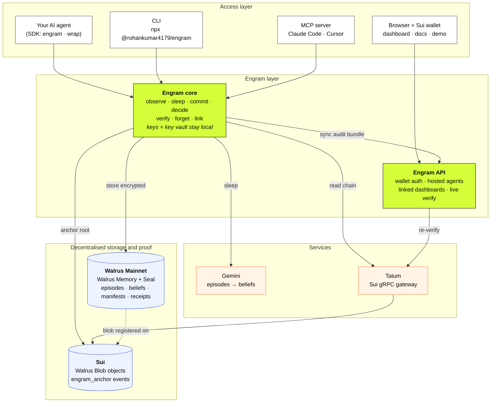

Reading the diagram from top to bottom:

#### Layer 1 · How you reach Engram

You can use Engram four ways, depending on who you are:

- **The SDK** wraps an agent you've already built. Your agent's logic doesn't change. Engram
  sits around it, handing it beliefs and collecting receipts.
- **The CLI** gives you every command, from `init` to `verify`, in your terminal.
- **The MCP server** puts Engram's tools inside Claude Code, Cursor and Claude Desktop, so an
  AI assistant can commit, blame and verify its own memory.
- **The web app** lets anyone sign in with a Sui wallet, run a hosted agent, or watch a linked
  agent on a dashboard.

#### Layer 2 · The Engram engine

**Engram core** does the real work: observe, sleep, commit, decide, verify and forget. It runs
on *your* machine, next to your agent. The agent's signing key and the vault of per-memory keys
never leave it.

**The Engram API** powers the website: wallet sign-in, hosted agents and linked dashboards. It
never holds your keys, and it **re-verifies everything** you send it before showing it.

#### Layer 3 · Helper services

**Gemini** does the "thinking" during `sleep`, turning episodes into beliefs, with every
answer checked against real evidence. **Tatum** is Engram's window onto the Sui blockchain:
every Mainnet chain read goes through Tatum's Sui gRPC gateway.

#### Layer 4 · Where trust comes from

**Walrus** stores everything durable: episodes, beliefs, snapshots and receipts, encrypted for
the owner. **Sui** holds the public proof: each stored item is registered as an object on Sui,
and our Move contract publishes each snapshot's fingerprint for anyone to read.

#### What leaves your machine, and what doesn't

| Stays with the owner | Goes to Walrus | Goes to Sui | Goes to the dashboard |
|---|---|---|---|
| Agent key, key vault, decrypted memories | Encrypted episodes, beliefs, manifests, receipts | Blob registrations and anchor events (Merkle roots) | Commits, beliefs and receipts, re-verified by the server |

#### What happens during a commit

Here's every step `engram commit` takes, in order:

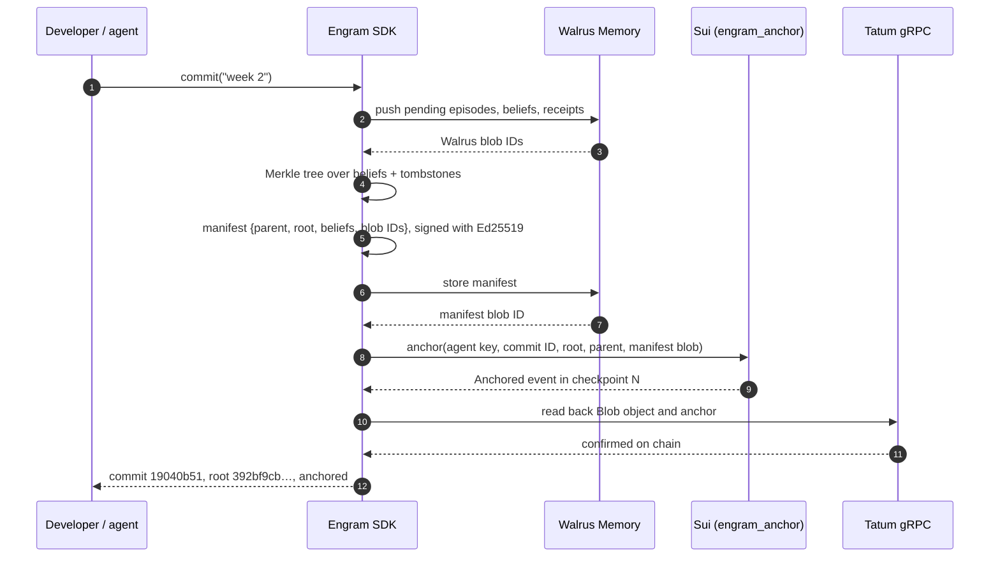

Engram doesn't just *send* the proof to the chain. It **reads it back through Tatum** to
confirm it landed before reporting success.

***

## Part 7 · How the proof works

This is the heart of Engram, so it's worth explaining slowly. We use only standard,
well-studied building blocks (SHA-256, Ed25519 signatures, AES-256-GCM encryption and Merkle
trees). There's no custom cryptography.

#### A fingerprint for the whole mind

Each belief is hashed into a short fingerprint. Those fingerprints are paired up and hashed
again, and again, until one fingerprint is left at the top: the **Merkle root**. That single
value represents the agent's entire mind at that moment. Change any belief, anywhere, and the
root changes.

#### Two public anchors for every commit

1. **Walrus registers every stored item as a `Blob` object on Sui.** So the snapshot itself
   gets an on-chain record of when it was stored.
2. **Our Move contract, `engram_anchor`, publishes the Merkle root in the clear.** It emits one
   `Anchored` event with the commit ID, the root and the agent's public key. It creates no
   objects, so it only costs gas. Anyone can read it, and nobody can change it afterwards.

That second anchor is what lets a stranger check a commit without trusting us and without
decrypting anything.

#### What `verify` checks

`engram verify`, and the **Verify** button on the website, run the same chain of checks. If
any one fails, the answer is **INVALID**. There's no "mostly valid."

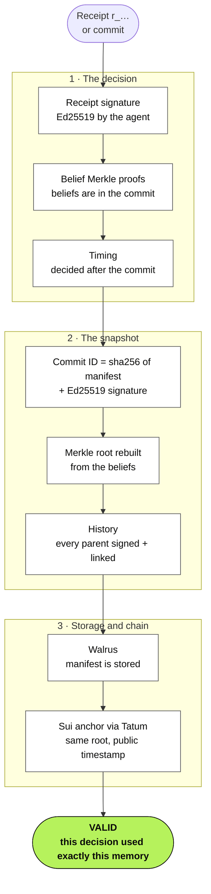

| Check | What it proves |
|---|---|
| Receipt signature | The agent really made this decision |
| Belief proofs | The beliefs it cited were really in that snapshot |
| Timing | The decision came *after* the snapshot, so it couldn't have been backfilled |
| Commit ID and signature | The snapshot belongs to this agent and hasn't been altered |
| Merkle root | The beliefs rebuild exactly the same fingerprint |
| History | Every earlier snapshot is signed and correctly linked |
| Walrus | The snapshot is really stored on Walrus |
| Sui anchor | The fingerprint was public on chain at that time |

Teams can also export an **audit bundle** (`engram export --audit`), and anyone can check it
with `engram audit <file>`, with no access to the agent at all.

***

## Part 8 · Forgetting, without rewriting history

This was the hardest design question in the whole project.

We chose Walrus *because* it's permanent and decentralised: nobody can quietly delete or edit
what's stored there. But people have a right to be forgotten. How can permanent storage
forget?

Our answer: **don't delete the data. Destroy the only key that can read it.**

Remember that every episode is encrypted with *its own* key before it's stored. Those keys live
in a vault on the owner's machine. To forget one memory, Engram destroys that one key. The
ciphertext stays on Walrus, but it's now meaningless noise, forever.

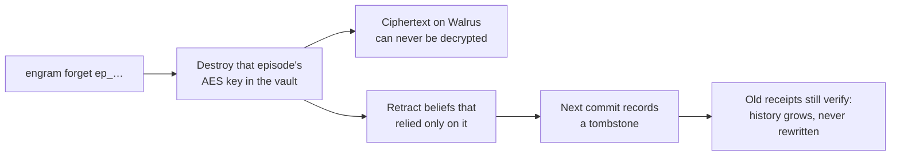

Two more things happen at the same time:

- Any belief that relied **only** on that memory is retracted, so the agent stops acting on it.
- The next commit records a **tombstone**: a note that this episode was forgotten, and when.

The history isn't rewritten. It grows. Old receipts still verify, because forgetting becomes
part of the record instead of a hole in it. You get a provable *"we forgot this, on this date"*
instead of *"trust us, it's gone."*

***

## Part 9 · Why Walrus, Sui and Tatum

Memory you want to **trust** shouldn't depend on trusting whoever runs the server. Engram
needed four things from its storage, and this stack provides all four.

| Engram needs… | The stack provides… | How Engram uses it |
|---|---|---|
| Memory no single party can quietly change or delete | **Walrus**: decentralised storage across independent nodes | Episodes, beliefs, snapshots and receipts all live on Walrus |
| A stable ID to point at in proofs | Every Walrus blob has an ID, registered as a `Blob` object on **Sui** | Commits list each episode's blob ID, `blame` shows them, `verify` checks them |
| Privacy: only the owner reads raw memories | **Walrus Memory** encrypts data for its owner with Seal | Engram adds its own per-memory key on top, which makes provable forgetting possible |
| A public clock, so history can't be backdated | **Sui** transactions and checkpoints | `engram_anchor` puts each commit's Merkle root in a public event |

#### Walrus Memory: where everything lives

Each kind of data gets its own Walrus Memory namespace (`engram-<agent>-episodes`,
`-beliefs` and so on). Walrus Memory's semantic recall finds the beliefs that matter for each
decision, so the agent gets *"what do I know about rent?"* instead of its whole memory. A
user's agent can also run on **their own** Walrus Memory account. The web app sets that up
with two wallet-signed transactions.

#### Sui: the public clock

Sui gives every commit a public timestamp nobody can move. Because each commit names its
parent, and each parent is anchored, the whole history is pinned in time.

#### Tatum: how Engram reads the chain

Every Mainnet chain read goes through **Tatum's Sui gRPC gateway**: Walrus `Blob` objects,
anchor transactions and the demo agent's live wallet feed. One `affectedAddress` query returns
every transaction that touched a wallet, sent *or* received, which is exactly what a wallet
watcher needs.

#### What only works because of this stack

- **`verify`** checks a decision against data no single party could have edited.
- **Linked dashboards stay honest.** Our server can't read your private memories, but it can
  still confirm each snapshot is stored on Walrus (through the public aggregator) and that its
  fingerprint is on Sui.
- **Forgetting with proof**, on storage that's permanent by design.

> **Private memory, stored openly, that anyone can verify.**

***

## Part 10 · The demo: an agent that learned from real money

We didn't want a scripted demo with fake data piped into the agent. So our example agent,
**money-ops**, watches a **real Sui wallet** through Tatum.

We created five wallets (an owner, an employer, a landlord, a streaming service and a
scammer) and sent real SUI between them: salary in, rent and a subscription out, a rent rise,
and a staged theft. The agent never sees the script. It reads the owner's wallet from the
chain like any other wallet, and the owner occasionally explains things in plain words, the
way a person would.

| Phase | On chain | What the agent does |
|---|---|---|
| **Month 1** | Salary in, rent and a subscription out. The owner explains them. | Alerts on all 3 (it knows nothing yet), then learns 3 beliefs |
| **Months 2–3** | The same six transfers again | **Quiet on all 6**, each receipt citing the belief it used |
| **Month 4** | Rent rises. 0.18 SUI leaves to an unknown address. The owner: *"that's a scammer."* | Warns about the rent change, flags the unknown payment, then revises the rent belief and learns the scam address |
| **Month 5** | New rent, and another payment to the scammer | Quiet on the new rent. **CRITICAL** alert on the scammer, from memory. |

That's the whole point in one table: the agent **learns**, **changes its mind** when the facts
change, and **remembers** a threat. And every step is provable.

#### Watching the agent think: the Mind view

The **Mind** view draws the agent's beliefs as a map. Each card in the middle is a belief, with
its confidence bar and how many pieces of evidence support it. The small tags around each card
are the episodes behind it: wallet events and things the owner said. The slider at the top
replays history commit by commit, so you can drag back to Month 1 and watch the agent learn.

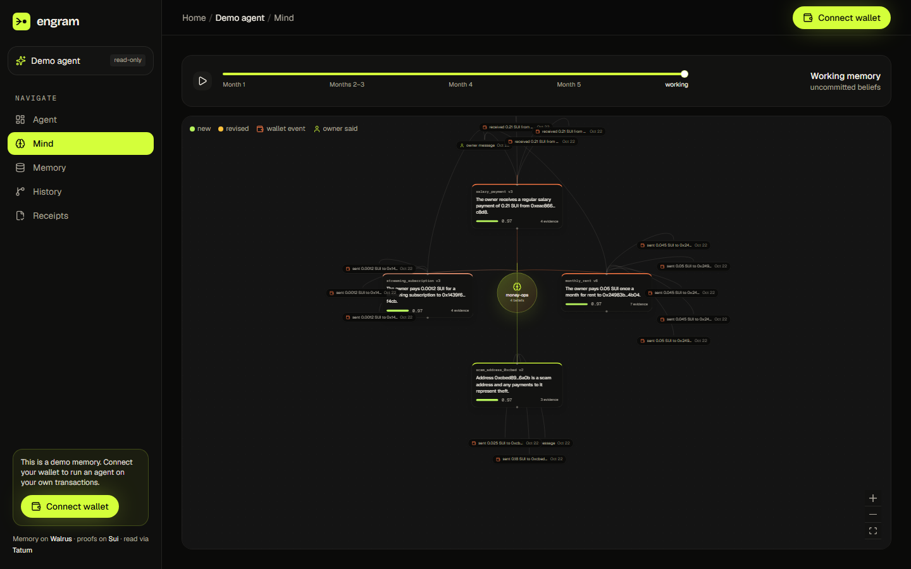

Notice the version numbers: `monthly_rent v5`, `salary_payment v3`. These beliefs weren't
written once. They were refined each time new evidence arrived.

#### Every memory, encrypted and on Walrus: the Memory view

The **Memory** view lists every raw episode: wallet events and owner messages. Each one shows
its Walrus blob ID, with a link to see it on the Walrus explorer. The explorer can prove the
blob exists, but not what it says, because only the owner holds the key. The *learned* tag
shows that an episode has already been consolidated into beliefs.

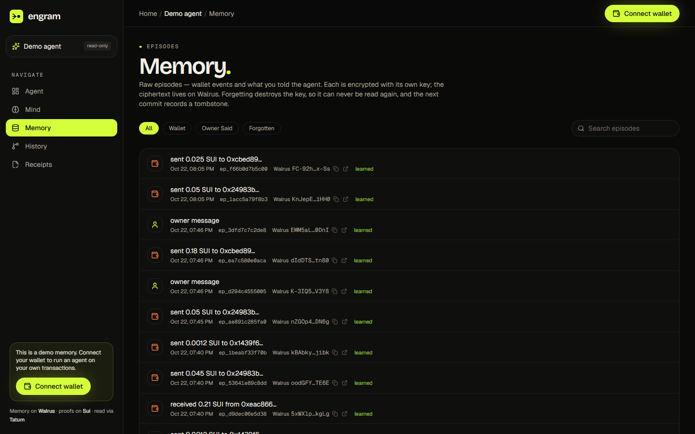

#### A history you can't rewrite: the History view

The **History** view is the agent's `git log`. Each card is one commit, showing which beliefs
were **added** (+) or **revised** (pencil), along with the Merkle root. On the right are the
links to the snapshot on Walrus and the anchor transaction on Sui, with its checkpoint number.
Look at Month 4: two new beliefs about the scam address, and revisions to rent, salary and
subscription, all in one signed, anchored snapshot.

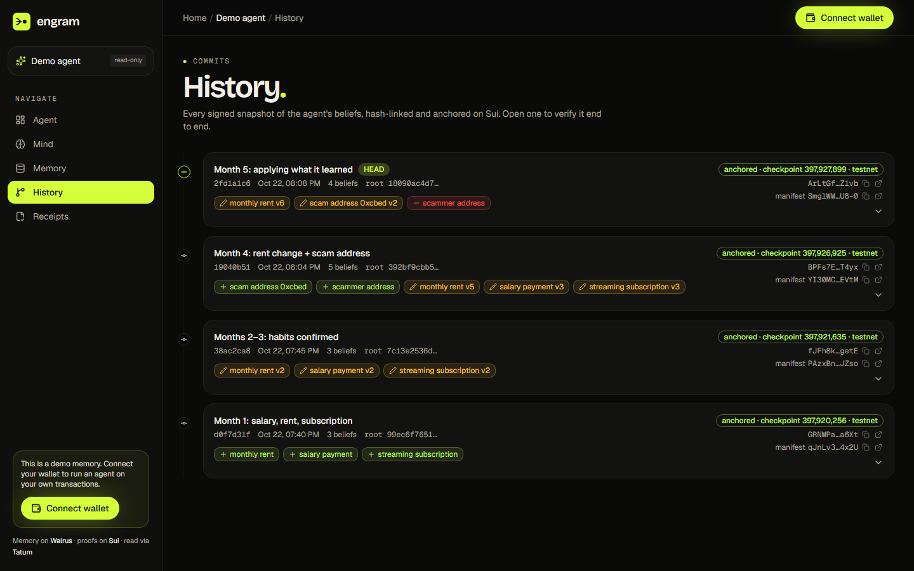

#### Every decision comes with a receipt: the Receipts view

This is where everything pays off. The agent made ten decisions and raised three alerts. Each
row shows the decision, the agent's reason, the **exact belief versions it used**, and the
commit those beliefs came from.

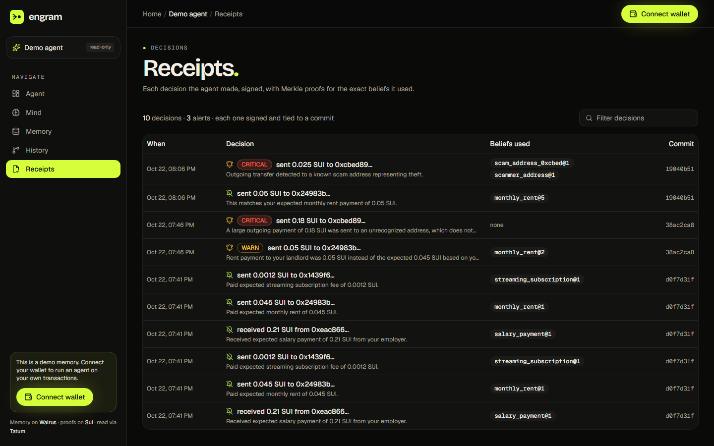

Read it from the bottom up and you can see the agent learn. Early decisions cite
`monthly_rent@1`. Then a **WARN** when the rent changed, citing `monthly_rent@2`. Then a
**CRITICAL** on the first payment to an unknown address, citing *none*, because the agent
hadn't learned about it yet. And at the top, the second payment to the scammer: **CRITICAL**,
citing `scam_address_0xcbed@1`, proven against commit `19040b51`.

#### Then anyone can check it

This is the live output for that scam alert. Click **Verify** on the site, or ask the API
yourself:

```
✔ receipt signature    "ALERT[critical]: sent 0.025 SUI to 0xcbed89… — Outgoing transfer detected
                        to a known scam address representing theft." signed by the agent
✔ belief proofs        2 belief(s) proven to be in commit 19040b51
✔ timing               decision made after its commit
✔ commit id            sha256 of the manifest matches the commit ID
✔ commit signature     Ed25519 by agent 0e648084a79c…
✔ commit merkle root   5 beliefs + 0 tombstones → root 392bf9cbb518…
✔ commit history       2 earlier commit(s), all signed and hash-linked
✔ commit walrus        manifest recalled from Walrus Memory, blob YI30MCNaOG…
✔ commit sui anchor    Anchored event: root 392bf9cbb5… public in checkpoint 397926925 (testnet)
✔ commit anchored at   2026-10-22T14:35:05.365Z
VALID
```

#### Check it without trusting us

You don't need our software, or our word, for any of this:

```bash
# 1. A memory is stored on Walrus Mainnet (HTTP 200; the content is encrypted)
curl -I https://aggregator.walrus-mainnet.walrus.space/v1/blobs/FC-92hYt6rX2P8oJy-pvKRMbOAW0g3V2DranpmQx-Ss

# 2. The Merkle root of commit 19040b51 is public on Sui
curl -s https://graphql.testnet.sui.io/graphql -H 'content-type: application/json' \
  -d '{"query":"{ transaction(digest: \"BPFs7EqazA9nxUtr5rGnjcAJb4eUqxsNTUcA2L5aT4yx\") { effects { events { nodes { contents { json } } } } } }"}'

# 3. The full proof check, through the live API
curl -s https://engram-blond.vercel.app/api/demo/verify/r_5080ccb4fd9c3869
```

**16 memories on Walrus Mainnet. 4 commits anchored on Sui. Every link checked before we
published.** The full list of blob IDs and transactions is in the
[README](README.md#on-chain-evidence-verify-it-yourself).

A note on honesty: the "theft" is staged, because the owner's own key signs it. But it's an
ordinary on-chain transfer, and the agent has no way to tell it apart from a real one. The
whole story moved about 0.75 SUI.

***

## Part 11 · Debugging an agent's mind

Proof is one half of Engram. The other half is everyday developer tooling, the commands you
reach for when an agent starts behaving strangely.

| Command | The question it answers |
|---|---|
| `log` | What has this agent learned, commit by commit? |
| `diff` | What changed in its beliefs between two points? |
| `checkout HEAD~1` or `checkout 2026-10-20` | What did it believe *then*? |
| `blame <belief>` | Which exact episodes (with Walrus blob IDs) taught it this? |
| `bisect <good> <bad>` | In which commit did it first start believing something wrong? |

`bisect` is the one we're proudest of. Like `git bisect`, it does a binary search through the
agent's history. You tell it one commit where the agent behaved well and one where it didn't,
and it narrows down to the exact snapshot where a bad belief first appeared. Combined with
`blame` and `forget`, you can go from *"the agent is acting weird"* to *"here's the memory that
caused it, and it's gone"* in a few commands.

***

## Part 12 · Using it today

#### In code: the SDK

Wrapping an existing agent takes a few lines. Your agent's logic stays the same:

```ts
import { engram } from "@rohankumar4179/engram-sdk";

const mind = engram({ agent: "money-ops" });   // Walrus Memory, Tatum, Gemini from .env

// Wrap your existing agent: relevant beliefs in, a signed receipt out.
const agent = mind.wrap(async (tx, beliefs) => myAgent.decide(tx, beliefs), {
  used: (decision) => decision.beliefIds,
});
const decision = await agent(tx);

mind.observe({ source: "tatum", data: tx });   // encrypted episode
await mind.sleep();                            // episodes → beliefs
await mind.commit("week 2");                   // signed, stored on Walrus, anchored on Sui
await mind.beliefs({ about: "rent" });         // Walrus Memory semantic recall
mind.at("2026-10-01");                         // time travel
mind.forget("ep_…");                           // provable forgetting
await mind.verify(agent.lastReceipt!.id);      // signature → proofs → Walrus → Sui
```

#### In the terminal: the CLI

```bash
npx @rohankumar4179/engram init my-agent
npx @rohankumar4179/engram observe "I pay 450 USDC rent to 0x7a11 on the 1st"
npx @rohankumar4179/engram sleep                   # episodes → beliefs
npx @rohankumar4179/engram commit -m "first week"  # signed → Walrus → Sui
npx @rohankumar4179/engram verify                  # ✔ … VALID
```

Needs Node 20+ and a `.env` with your keys ([configuration](https://engram-blond.vercel.app/docs#configuration)).
On Windows PowerShell, use `npx.cmd`.

#### Inside your AI assistant: MCP

Add one entry to Claude Code, Cursor or Claude Desktop, and your assistant gets Engram's tools:

```json
{ "mcpServers": { "engram": { "command": "npx", "args": ["@rohankumar4179/engram", "mcp", "-C", "/path/to/agent"] } } }
```

#### On the web: link your agent to a dashboard

Linking works like `gh auth login`. The CLI shows a one-time code, and you approve it on the
website with your Sui wallet. Signing in is one free text signature, never a transaction.

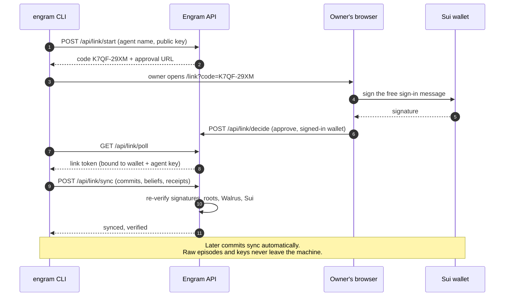

After that, every commit syncs automatically. Only commits, beliefs and receipts are uploaded,
never raw episodes or keys. A link token only accepts bundles signed by that agent's key, and
history can only grow, never be replaced.

***

## Part 13 · What broke, and how we fixed it

Building on live infrastructure during a hackathon means the ground moves under you. Here's
what broke, and what we learned from it.

#### Sui JSON-RPC went away

Sui switched JSON-RPC off, and Tatum's JSON-RPC gateway started answering *"No healthy
upstream"* to every call. We rewrote our Tatum client on **gRPC**. Tatum serves native gRPC
rather than gRPC-Web, so we use a native transport. The upside: one `affectedAddress` query
now gives us everything a wallet watcher needs.

#### Walrus Memory's embedder went down

On 22 October, Walrus Memory's server-side embedding failed
([MemWal#1285](https://github.com/MystenLabs/MemWal/issues/1285)). Rather than wait, we added a
fallback to Walrus Memory's manual mode: Engram embeds locally, Seal-encrypts with the owner's
key, and the relayer only ever stores ciphertext. Reads merge both paths, so `verify` never
noticed the switch.

#### The relayer rate-limits each key

Walrus Memory's relayer allows 60 requests a minute per key. Engram now waits out `429`
responses using the relayer's own `retry_after_seconds`, instead of failing.

#### LLM free tiers are small

Decisions are batched, quota errors rotate between keys and models, and a failed wallet sync no
longer stops the agent from learning what the owner told it.

***

## Part 14 · Honest limits

We'd rather you hear these from us:

- **Forgetting can't un-read a copy.** If someone already decrypted a memory before it was
  forgotten, destroying the key can't undo that. And the *summaries* of retracted beliefs stay
  in history, clearly marked as retracted.
- **Snapshots are encrypted for the owner.** Outsiders confirm a snapshot exists on Walrus and
  check its content through the public Merkle root on Sui, rather than reading it directly.
- **Keys live on disk** in `.engram/` today. Moving them to Seal or a key management service is
  on the roadmap.
- **The Move anchor runs on Sui Testnet** today. The memories on Walrus and the Tatum chain
  reads are on Mainnet.

***

## Part 15 · What we shipped, and what's next

#### Built during the hackathon

| Piece | Status |
|---|---|
| **CLI**: `init` · `observe` · `sleep` · `commit` · `log` · `diff` · `checkout` · `blame` · `bisect` · `verify` · `forget` · `export`/`audit` · `link`/`sync` · `mcp` | Published on npm: `npx @rohankumar4179/engram` |
| **TypeScript SDK**: wrap any agent, get signed receipts | Published on npm: `@rohankumar4179/engram-sdk` |
| **MCP server**: 10 tools for Claude Code, Cursor and Claude Desktop | Done |
| **Move contract** `engram_anchor` | Live on Sui Testnet |
| **Tatum Sui gRPC** for every Mainnet chain read | Done |
| **money-ops** example agent on real wallet transactions | Done |
| **Web app**: wallet sign-in, hosted agents, linked CLI agents, live verify, public demo, docs | Live at [engram-blond.vercel.app](https://engram-blond.vercel.app) |
| **Tests** | SDK 62 · CLI 10 · money-ops 6 · server 20, all passing |

#### Next few months

- The **Move anchor on Sui Mainnet**, so roots are public on Mainnet as well as Testnet
- **Plug-ins** for the Vercel AI SDK, LangChain, the Claude Agent SDK and Mastra
- A **Python SDK** with the same API
- **Scoped sharing**: hand part of a memory (say, only the `finance` beliefs) to another agent,
  with an expiry date

#### Further out

- **Team dashboards**: many agents, many team members, and alerts when a belief changes
- **Paid memory sharing**: agents sell scoped knowledge to each other on Sui, with proof of
  exactly what was sold
- **Keys in Seal or a KMS** instead of on disk
- A **public verification page**: paste a receipt, get a verdict, nothing to install

#### What success looks like

Developers reach for Engram when they need to **debug** an agent. Teams use it to **audit**
one. And users trust an agent because they can **check** what it remembered, instead of being
asked to take it on faith.

***

## Try it

| | |
|---|---|
| **Demo video** | https://drive.google.com/file/d/1FrONLRpjajndGVA5p4gFmyBfKeEy8jXw/view?usp=drivesdk |
| **This post on dev.to** | https://dev.to/roan911/your-ai-agent-remembers-everything-can-it-prove-any-of-it-51og |
| **Live demo agent** (no wallet needed) | https://engram-blond.vercel.app/demo |
| **Web app** | https://engram-blond.vercel.app |
| **Docs** | https://engram-blond.vercel.app/docs |
| **Code** | https://github.com/rohan911438/Engram |
| **CLI** | [`@rohankumar4179/engram`](https://www.npmjs.com/package/@rohankumar4179/engram) |
| **SDK** | [`@rohankumar4179/engram-sdk`](https://www.npmjs.com/package/@rohankumar4179/engram-sdk) |
| **Anchor package** (Sui Testnet) | [`0xa1fccbb3…bf86b`](https://suiscan.xyz/testnet/object/0xa1fccbb3e282e4ca09efbb2a46b3584d038fd154b9f9db36fc8d60d9051bf86b) |

***

*Agents are getting memories. We think those memories should come with a history you can read,
a proof you can check, and an off switch you can trust.*

**Walrus Memory gives agents memory. Engram gives that memory history, proof and control.**
